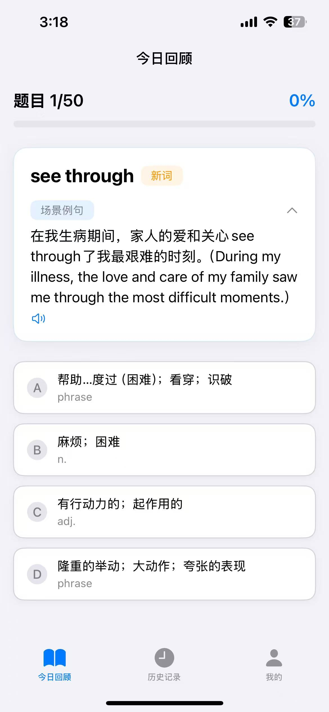
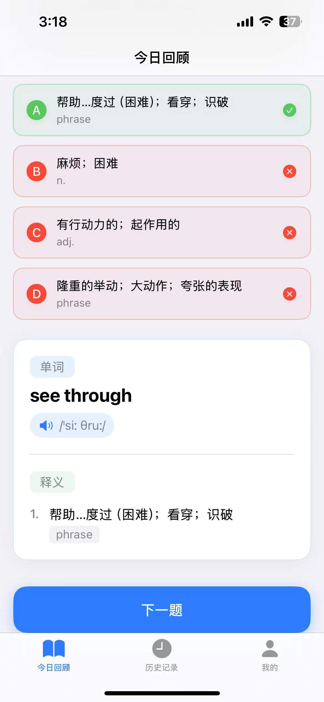
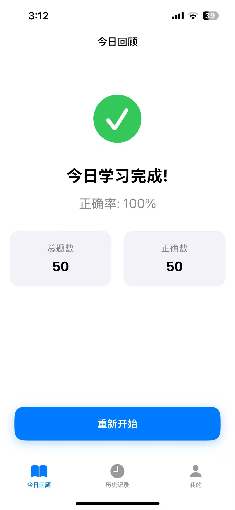
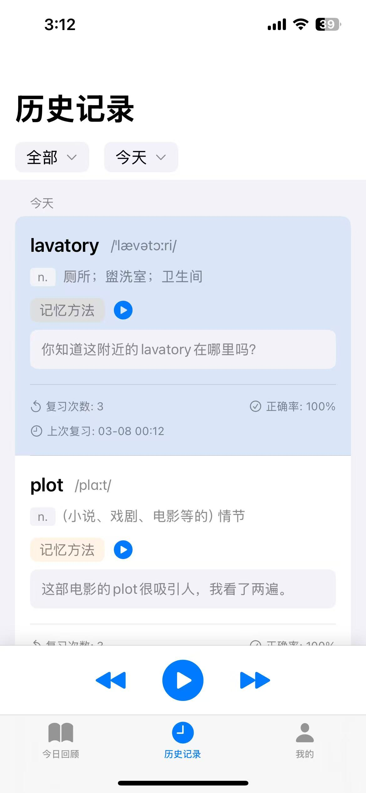
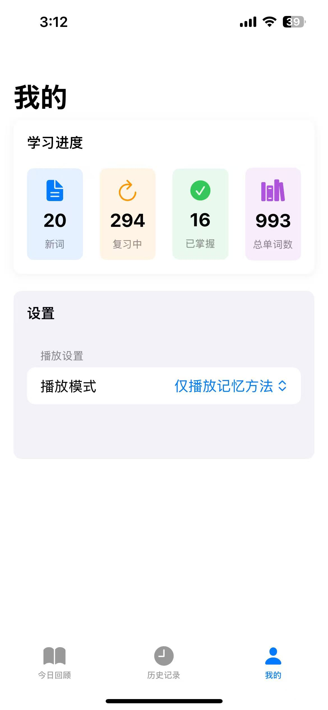

# Kumarajiva-iOS

[](https://developer.apple.com/ios/)
[](https://swift.org/)
[](LICENSE)

基于间隔重复与记忆技巧的英语单词学习应用，SwiftUI + MVVM，配套 Node.js(Fastify) 后端。

|  |  |  |
| :---: | :---: | :---: |
|  |  |  |
|  |  |  |

## 功能

- **间隔重复复习** — 记忆曲线安排复习时机，按表现自适应调整难度
- **多模态音频** — 有道 TTS + Microsoft Edge TTS，中英混读，0.5x-2.0x 变速、循环、锁屏控制、批量播放
- **语音练习** — WhisperKit 本地识别（隐私不出端），发音实时评分 + 录音回放
- **账号体系** — GitHub OAuth + JWT，Token 存 Keychain 并自动续期
- **进度面板** — 新学/复习中/已掌握统计与成就

## 技术栈

```
iOS:   SwiftUI + MVVM, AVFoundation, WhisperKit, Keychain
后端:  Node.js (Fastify) + SQLite3
认证:  GitHub OAuth + JWT
```

源码结构：`Models/` `Views/` `ViewModels/` `Services/`（APIService、AuthService、AudioService、EdgeTTSService、WhisperKitService）`Utils/`。

## 环境要求

iOS 15.0+ · Xcode 14.0+ · Swift 5.7+ · iPhone / iPad · 需联网同步

## 快速开始

```bash
# 1. 后端（独立仓库，详见其 README）
git clone https://github.com/nowszhao/Kumarajiva-API.git
cd Kumarajiva-API/api && npm install && cp env.example .env && npm start

# 2. 客户端
git clone https://github.com/nowszhao/Kumarajiva-iOS.git
open Kumarajiva-iOS/Kumarajiva-iOS.xcodeproj   # 选择开发团队与 Bundle ID 后 Cmd+R
```

### 配置

- 后端地址：`APIService.swift` 中的 `baseURL`（接口文档见仓库内 `API Docs/`）
- OAuth 回调：在 `Info.plist` 的 `CFBundleURLSchemes` 中配置 `kumarajiva-ios`
- YouTube 音频代理（可选）：`pip3 install flask yt-dlp` 后 `python3 youtube_audio_proxy_server.py`；YouTube 现需登录态，先导出 `cookies.txt`，见 `YOUTUBE_COOKIES_SETUP.md`

## 贡献

Fork → 功能分支 → PR。问题与建议请提交 [Issues](https://github.com/nowszhao/Kumarajiva-iOS/issues)。

## 致谢

[WhisperKit](https://github.com/argmaxinc/WhisperKit) · AVFoundation · SwiftUI

## License

MIT
